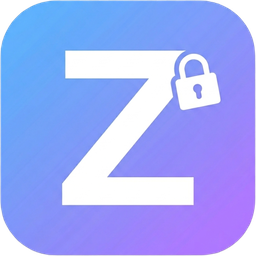
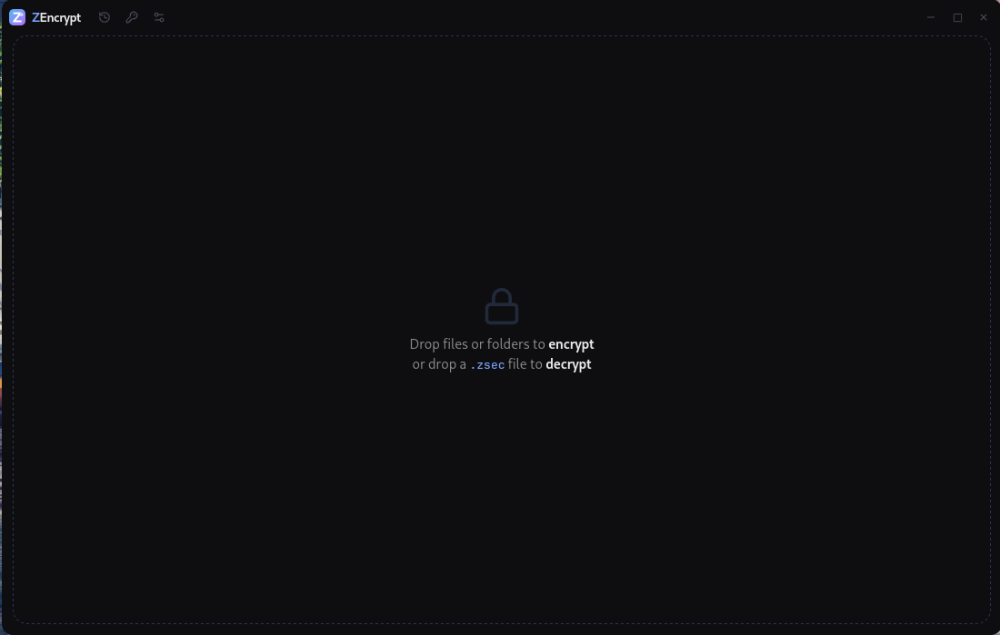
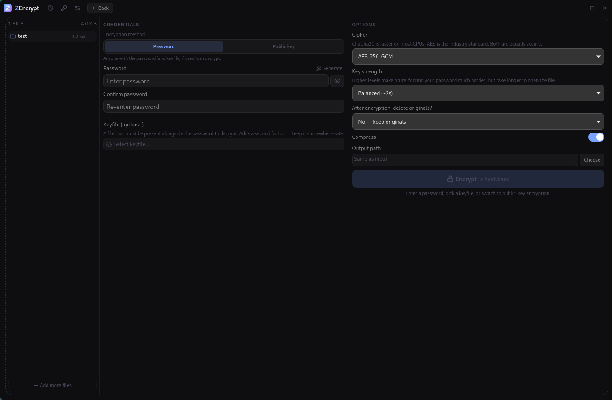
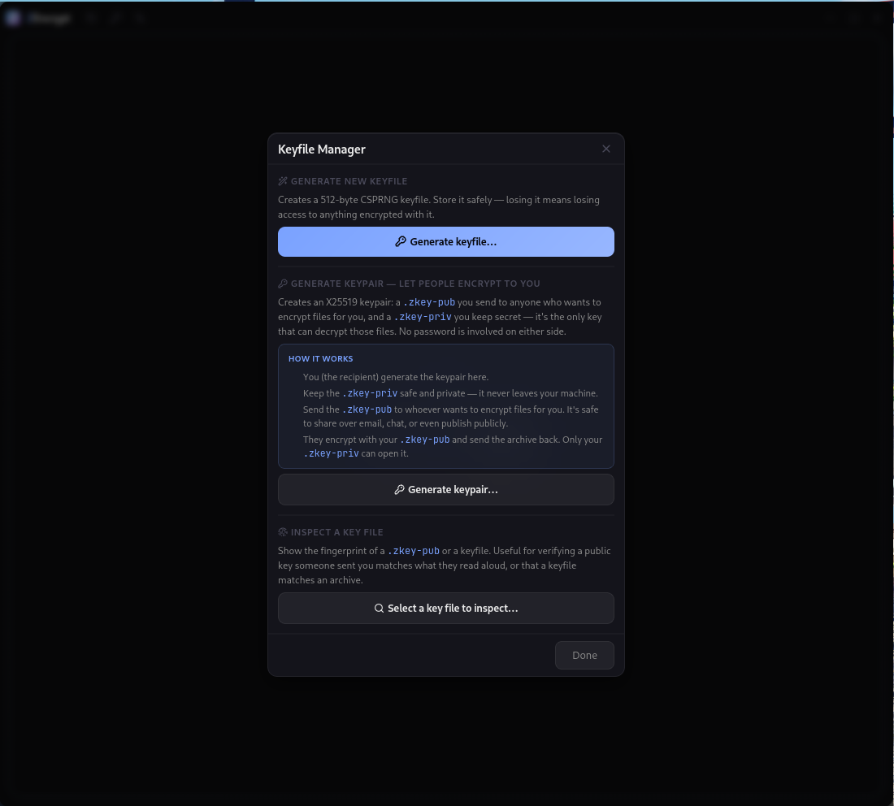
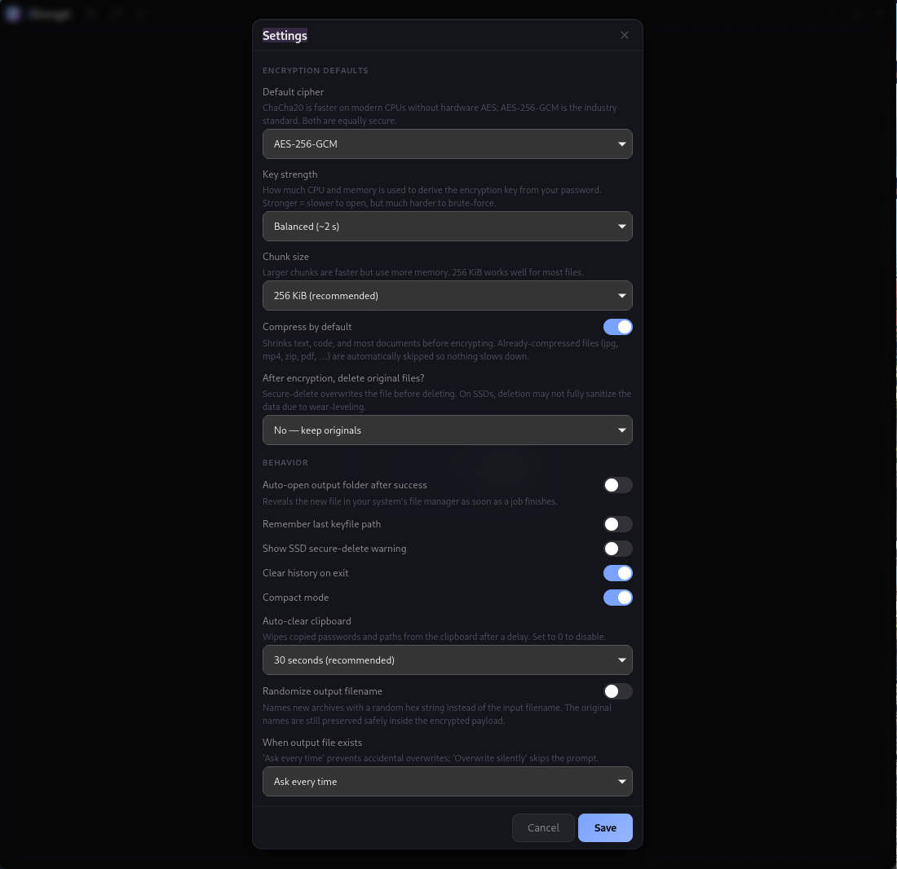

<div align="center">



# ZEncrypt

**Drag-and-drop file & folder encryption for people who don't want to touch a CLI.**

Drop a file or folder, set a password, a keyfile, or a recipient's public key — get back a single authenticated `.zsec` archive. Decrypt it anywhere ZEncrypt runs. No cloud, no key servers, no accounts.

<sub>Tauri 2 · Rust · React 19 · ChaCha20-Poly1305 · AES-256-GCM · Argon2id · BLAKE3 · X25519</sub>

</div>

---

## Screenshots

<table>
<tr>
<td align="center" width="50%">

<br /><sub><b>Idle drop zone</b> — drag files or folders to encrypt, drop a <code>.zsec</code> to decrypt.</sub>
</td>
<td align="center" width="50%">

<br /><sub><b>Encrypt screen</b> — password or public-key mode, optional keyfile, cipher and KDF cost, compression toggle.</sub>
</td>
</tr>
<tr>
<td align="center" width="50%">

<br /><sub><b>Decrypt screen</b> — header preview shows cipher, KDF cost and keyfile fingerprint before you type anything.</sub>
</td>
<td align="center" width="50%">

<br /><sub><b>Keyfile Manager</b> — generate a 512-byte keyfile or an X25519 keypair, or inspect any key file's fingerprint.</sub>
</td>
</tr>
<tr>
<td align="center" colspan="2">

<br /><sub><b>Settings</b> — defaults for cipher, KDF cost, chunk size, secure-delete, clipboard auto-clear, randomized output filename.</sub>
</td>
</tr>
</table>

---

## Why ZEncrypt

| Tool | Why it falls short for "encrypt this and send it" |
|---|---|
| VeraCrypt | Volume-based. Overkill for sharing a single file. |
| GPG | CLI-first, painful key management, terrible UX for non-experts. |
| 7-Zip / WinRAR password | Not authenticated. Leaks filenames in the ZIP table. |
| age / rage | Great CLI, no GUI. |
| `openssl enc` | Nobody remembers the incantation. |

ZEncrypt is the missing GUI: modern AEAD ciphers, real KDF, public-key support, drag-and-drop, no setup.

---

## Features

<table>
<tr>
<td width="50%" valign="top">

### Three ways to encrypt

- **Password** — Argon2id-hardened, with a live entropy meter and a one-click generator.
- **Keyfile** — any file becomes a keyfile (512-byte CSPRNG generator built in). Mix with a password for two-factor decryption.
- **Public key** — X25519 keypair recipients (`.zkey-pub` / `.zkey-priv`). Share the public half anywhere; only the holder of the private half can decrypt.

</td>
<td width="50%" valign="top">

### Built for sharing, not for vaults

- One drag, one archive, one file to send.
- Filenames and folder structure live **inside** the encrypted payload — the outside leaks nothing.
- Open `.zsec` files by double-clicking (file association registered on install).
- Drag the finished archive straight out of the success screen into a chat or upload widget.

</td>
</tr>
<tr>
<td valign="top">

### Modern, audited primitives

- **AEAD:** ChaCha20-Poly1305 (default) or AES-256-GCM.
- **KDF:** Argon2id — three presets, plus manual control.
- **Integrity:** per-chunk AEAD tags + a trailing BLAKE3 root over the full plaintext stream.
- **Streaming:** STREAM construction (Hoang–Reyhanitabar–Rogaway–Vizár) so truncation, reordering and chunk-substitution are all caught.

</td>
<td valign="top">

### Honest UX

- Verify integrity **without decrypting** — useful before deleting an original.
- Progress + ETA + throughput, debounced cancel, atomic rename so a cancelled job leaves zero residue.
- Header preview before you type any password: see cipher, KDF cost, keyfile fingerprint, recipient fingerprint.
- Clear error buckets: "wrong credentials" looks different from "file corrupted."

</td>
</tr>
</table>

---

## How encryption works (pick one)

<details>
<summary><b>Password mode</b> — for personal archives and one-off shares where you can communicate the password out-of-band.</summary>

You type a password. ZEncrypt runs it through Argon2id (interactive / moderate / paranoid preset, or custom) to derive a 256-bit key. The recipient needs the same password to decrypt.

Strength matters. The UI shows a live entropy estimate. The built-in generator produces high-entropy passwords; the clipboard auto-clears after a configurable delay so the password doesn't linger.

</details>

<details>
<summary><b>Keyfile mode</b> — for two-factor decryption or for completely password-free flows.</summary>

Any file can be a keyfile (binary, photo, song — doesn't matter). ZEncrypt hashes it with BLAKE3 and feeds that into Argon2id. You can use a keyfile alone, or combine it with a password — in which case **both** are required to decrypt, and a stolen password alone is useless.

The keyfile fingerprint (first 4 bytes of BLAKE3) is stored in the header so the recipient can verify they're using the right one before they even try a password.

</details>

<details>
<summary><b>Public-key mode</b> — for "I want strangers to be able to encrypt files to me without sharing a secret first."</summary>

The **recipient** generates an X25519 keypair in the Keyfile Manager. They get two files:

- `.zkey-pub` — share it freely. Email it, tweet it, post it on your website. It can only encrypt, never decrypt.
- `.zkey-priv` — keep it secret. It is the only key in the universe that can open archives encrypted to its public half.

The **sender** picks the recipient's `.zkey-pub` in the encrypt screen, drops files, hits Encrypt. ZEncrypt generates a fresh ephemeral X25519 keypair per archive, does ECDH to derive a wrap key, encrypts the per-archive file key with ChaCha20-Poly1305, and embeds the ephemeral public key + wrapped file key in the header.

No password is involved on either side. No pre-shared secret. The recipient's fingerprint is shown in the header so the sender can verify they're encrypting to the right person.

> **Warning:** losing your `.zkey-priv` permanently destroys access to every archive ever encrypted to its public half. There is no recovery. Back it up.

</details>

---

## The `.zsec` format

A `.zsec` file is a single binary blob with this layout:

```
+---------------------------+
| 63-byte plaintext header  |  magic + version + cipher + flags + KDF params + base nonce
+---------------------------+
| optional 4-byte keyfile   |  present when HAS_KEYFILE flag is set (v2+)
| fingerprint               |
+---------------------------+
| optional 88-byte pubkey   |  ephemeral X25519 pubkey + recipient fingerprint + wrapped key (v3+)
| block                     |
+---------------------------+
| chunked AEAD payload      |  [u32 chunk_len_with_flag][ciphertext || 16-byte tag], repeated
|                           |  high bit of length prefix marks the final chunk
+---------------------------+
| 32-byte BLAKE3 root       |  hash of pre-AEAD plaintext, defence-in-depth over per-chunk tags
+---------------------------+
```

Format version 3. The header is passed as AAD to every chunk, so any tampering with cipher choice, KDF params, or the pubkey block breaks all subsequent decryptions.

<details>
<summary><b>What an attacker with the file learns</b></summary>

- That it's a ZEncrypt archive (the magic bytes are public — this is true of every encrypted format).
- Roughly how big the plaintext was (from total file size, +/- chunk overhead and zstd compression).
- The cipher choice, KDF parameters, and (if pubkey mode) the recipient fingerprint.

That's it. Filenames, folder structure, file count, individual file sizes, and content are all encrypted inside the payload.

</details>

---

## What it can do

<table>
<tr><th>Area</th><th>Capability</th></tr>
<tr>
<td valign="top"><b>Input</b></td>
<td>

- Drag files or folders onto the window
- Mix files and folders freely — they're packed into a single tar inside the archive
- File picker fallback (Open File / Open Folder)
- No size limit — everything streams
- Configurable chunk size (64 KiB / 256 KiB / 1 MiB)

</td>
</tr>
<tr>
<td valign="top"><b>Encrypt</b></td>
<td>

- ChaCha20-Poly1305 (default) or AES-256-GCM
- Argon2id with Interactive (~0.5s) / Moderate (~2s) / Paranoid (~5s) presets
- zstd compression on by default — automatically skipped for already-compressed extensions (jpg, mp4, zip, pdf, …)
- Optional secure-delete of source files after success: 1-pass, 3-pass DoD, or 7-pass Gutmann-lite
- Verify-then-delete: the new archive is integrity-checked before any source is touched

</td>
</tr>
<tr>
<td valign="top"><b>Decrypt</b></td>
<td>

- Header preview before typing any credentials
- Wrong-credentials error is distinct from corrupted-file error
- Verify integrity without writing plaintext to disk
- Live decryption progress with throughput + ETA

</td>
</tr>
<tr>
<td valign="top"><b>Reliability</b></td>
<td>

- Cancel any running job — partial files are cleaned up automatically
- Atomic rename: an interrupted encrypt never leaves a half-written `.zsec` posing as a complete one
- Cancel button has a confirmation step to prevent accidental clicks during long Argon2id derivations
- Single-instance enforcement — double-clicking a `.zsec` opens it in your existing window

</td>
</tr>
<tr>
<td valign="top"><b>History</b></td>
<td>

- Recent operations stored in a local SQLite database (WAL mode)
- One-click re-run from history
- Clear-on-exit option for ephemeral workflows

</td>
</tr>
<tr>
<td valign="top"><b>Privacy ergonomics</b></td>
<td>

- Clipboard auto-clear (off / 15s / 30s / 1min / 2min) for copied passwords and paths
- Randomize-output-filename option — the new archive's filename leaks nothing about the input
- SSD warning the first time secure-delete is enabled (overwriting on SSDs is best-effort due to wear-levelling)
- Caps-lock indicator and password-visibility toggle in credentials fields
- No telemetry. No analytics. No network calls of any kind.

</td>
</tr>
<tr>
<td valign="top"><b>Look & feel</b></td>
<td>

- Frameless transparent window with glassmorphism (auto-falls-back to opaque on non-compositing desktops)
- Compact mode for smaller windows
- System tray icon — open or quit from the tray menu
- Window state persisted across launches

</td>
</tr>
</table>

---

## Keyboard shortcuts

| Shortcut | Action |
|---|---|
| <kbd>Ctrl</kbd>+<kbd>E</kbd> | Encrypt the staged files |
| <kbd>Ctrl</kbd>+<kbd>D</kbd> | Decrypt the loaded archive |
| <kbd>Ctrl</kbd>+<kbd>H</kbd> | Open recent history |
| <kbd>Ctrl</kbd>+<kbd>K</kbd> | Open Keyfile Manager |
| <kbd>Ctrl</kbd>+<kbd>,</kbd> | Open Settings |
| <kbd>Esc</kbd> | Close modal / cancel running job |

---

## Settings reference

<details>
<summary><b>Defaults</b></summary>

- **Default cipher** — ChaCha20-Poly1305 or AES-256-GCM. Both are equally secure; ChaCha is faster on CPUs without AES-NI (ARM, older x86, most mobile).
- **Default KDF preset** — Interactive (fast), Moderate, or Paranoid (1 GiB memory, ~5s).
- **Default chunk size** — 64 KiB (low memory), 256 KiB (recommended), or 1 MiB (fastest).
- **Compress by default** — Smart compression with an extension skip-list.
- **Default secure-delete mode** — Off, 1 pass, 3 pass (DoD 5220.22-M), or 7 pass (Gutmann-lite).

</details>

<details>
<summary><b>Behavior</b></summary>

- **Auto-open output folder after success**
- **Remember last keyfile path** — pre-fills the keyfile picker between sessions.
- **Show SSD secure-delete warning** — disable after you've read it once.
- **Clear history on exit**
- **Compact mode** — tighter spacing for smaller windows.
- **Auto-clear clipboard** — 0 / 15s / 30s / 60s / 120s.
- **Randomize output filename** — replaces the input-derived name with random hex.
- **When output file exists** — "Ask every time" vs. "Overwrite silently."

</details>

---

## Download

Pre-built binaries for Linux, macOS (Intel + Apple Silicon), and Windows are published at **<https://zsync.eu/zencrypt/>**. Each release ships with SHA-256 checksums.

Available formats:

- **Windows** — `.msi` and `.exe` (NSIS)
- **macOS** — `.dmg` (separate Intel x64 and Apple Silicon builds)
- **Linux** — `.deb`, `.rpm`, `.AppImage`

---

## Building from source

<details>
<summary><b>Prerequisites</b></summary>

- Rust toolchain (stable)
- Node 24+ and pnpm 10.33+
- Platform build tools for Tauri 2 — see the [Tauri prerequisites page](https://tauri.app/start/prerequisites/)

</details>

```bash
git clone https://github.com/TheHolyOneZ/ZEncrypt.git
cd ZEncrypt
pnpm install
pnpm tauri dev      # run in dev mode
pnpm tauri build    # produce a release bundle for your platform
```

The Tauri build produces native installers (deb / rpm / AppImage on Linux, dmg on macOS, msi / nsis on Windows) in `src-tauri/target/release/bundle/`.

---

## Links

| | |
|---|---|
| **Project repository** | <https://github.com/TheHolyOneZ/ZEncrypt> |
| **Pre-built binaries** | <https://zsync.eu/zencrypt/> |
| **Developer GitHub** | <https://github.com/TheHolyOneZ> |
| **More projects** | <https://zsync.eu/> |

These are also reachable from the About panel inside the app (top-left logo).

---

## Threat model & non-goals

ZEncrypt assumes a **trusted local machine** at encrypt/decrypt time. It is not a vault, not a session manager, and does not aim to protect against:

- A malicious operating system or compromised user account
- Hardware attackers with physical access at the time you're typing your password
- Side channels (timing, power, EM) against the local CPU
- Loss of your own credentials — there is no recovery, by design

It **does** aim to protect against:

- Anyone who intercepts or stores the encrypted archive (cloud storage, email provider, ISP, USB drive in a drawer)
- Tampering with the archive in flight (any byte flip is detected, no plaintext is released)
- Truncation or chunk reordering attacks (caught by the STREAM construction and BLAKE3 root)
- Wrong-keyfile confusion (header carries a fingerprint hint)
- Phishing your password alone, if you also use a keyfile or public key

---

## License

Copyright (C) 2026 TheHolyOneZ

ZEncrypt is free software: you can redistribute it and/or modify it under the terms of the **GNU General Public License version 3, or (at your option) any later version**, as published by the Free Software Foundation.

This program is distributed in the hope that it will be useful, but **WITHOUT ANY WARRANTY**; without even the implied warranty of MERCHANTABILITY or FITNESS FOR A PARTICULAR PURPOSE. See the [GNU General Public License](LICENSE) for more details.

You should have received a copy of the GNU General Public License along with this program. If not, see <https://www.gnu.org/licenses/gpl-3.0.html>.

---

<div align="center">

<sub>Made for people who want strong, modern encryption without becoming cryptographers.</sub>

</div>
